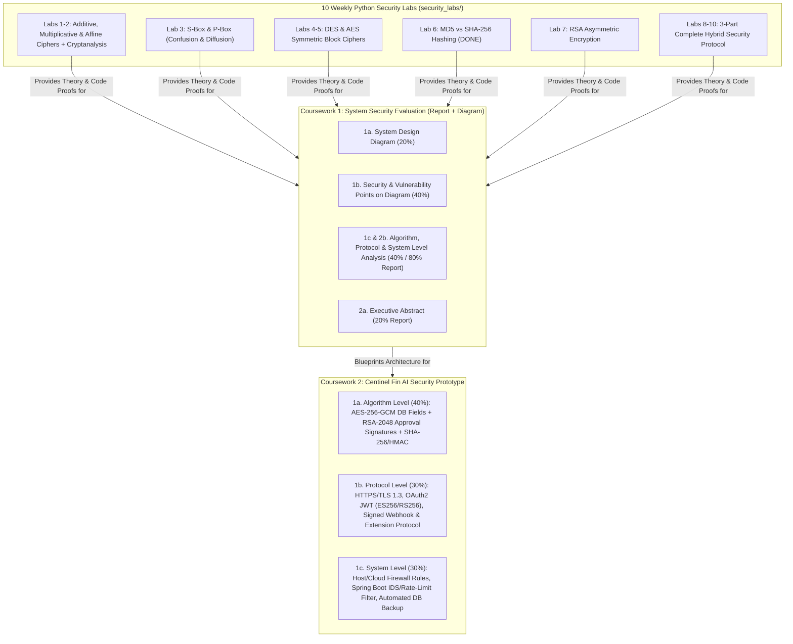

# NB6005CEM Security & Centinel Fin AI (ParentGuard) — 17-Day (2.5-Week) Master Execution & Learning Blueprint

> **Student Profile:** BSc (Hons) Computer Science with Artificial Intelligence (Coventry University / NIBM)  
> **Module:** `NB6005CEM Security` (CW1 System Security Evaluation + CW2 Prototype Implementation + 10 Weekly Labs)  
> **Target Project:** `Centinel Fin AI – ParentGuard` (`D:\Centinel Fin AI`)  
> **Pace:** **4 to 5 Hours / Day** across **17 Days (2.5 Weeks)**  
> **Target Grade Band:** **First Class Honours (80–100% Distinction)**

---

## 1. Executive Audit: Where You Stand Right Now

Before starting Day 1, here is what is **already completed** in your repository (`D:\Centinel Fin AI`) versus what remains:

| Component / Deliverable | Current Status | Remaining Work |
| :--- | :--- | :--- |
| **Spring Boot 3 Core Ledger & ParentGuard APIs** | **85% Done** (`User`, `Family`, `PurchaseRequest`, `Transaction`, `Summary`, `Masking`, 129/129 unit tests passing) | Add CW2 cryptographic services (`AES-GCM`, `RSA Signatures`, `HMAC-SHA256`), IDS filter, and Gemini AI service |
| **Supabase Auth & Next.js 15 Portal** | **85% Done** (Sign-In, Sign-Up, RBAC `ROLE_PARENT` / `ROLE_CHILD`, `middleware.ts`, Vitest + 5/5 Playwright E2E tests) | Connect live analytics charts, ParentGuard cryptographic approval badge view, and AI insight chat panel |
| **NB6005CEM 10 Weekly Security Labs** | **10% Done** (`security_labs/lab06_hashing.py` complete) | Complete Labs 1–5 and Labs 7–10 in `D:\Centinel Fin AI\security_labs\` |
| **NB6005CEM Coursework 1 (CW1 Report & Diagram)** | **25% Done** (Base architecture diagrams exist in `docs/`) | Draw CW1 Security Evaluation Diagram (marking Access Control, Firewall, Encryption & Vulnerability points) + Write CW1 Technical Report (Abstract + 3-Layer Security Analysis with APA 7th references) |
| **NB6005CEM Coursework 2 (CW2 Security Prototype)** | **40% Done** (OAuth2/JWT ES256/RS256 validation, API Key interceptor, PAN regex masking) | Implement Algorithm-level (40%), Protocol-level (30%), and System-level (30%) security controls directly into Centinel Fin AI |
| **ParentGuard Chrome Extension (Manifest V3)** | **0% Done** (Planned in `Centinal fin AI overview final.pdf`) | Build Service Worker, Checkout Detection Content Script, and Manual Request Popup verifying RSA-signed parent approval tokens |

---

## 2. How CW1, CW2, Labs & Centinel Fin AI Map Together

---

## 3. Phase 1 (Days 1–3): Classical & Symmetric Cryptography + Labs 1 to 5

> **Phase Goal:** Master the foundational cryptography concepts required by `NB6005CEM`, finish Labs 1 to 5 in Python, and implement **AES-256-GCM Symmetric Encryption** inside the Centinel Fin AI Spring Boot backend (CW2 Task 1a).

---

### Day 1: Modular Arithmetic & Classical Ciphers (Labs 1 & 2)

#### 1. Learn First (CS with AI Undergrad Focus — 1.5 Hours)
* **What You Need to Know:**
  - **Plaintext ($P$), Ciphertext ($C$), and Key ($K$):** Encryption transforms readable data into unreadable data using a mathematical key.
  - **Modular Arithmetic ($\pmod{26}$):** Classical English ciphers map letters `A–Z` to numbers `0–25`. Modulo `26` simply means "wrap around after 25" (like a 12-hour clock).
  - **Additive (Caesar) Cipher:** $C = (P + K) \pmod{26}$ and $P = (C - K) \pmod{26}$.
  - **Multiplicative Cipher:** $C = (P \times K_1) \pmod{26}$. **Crucial Viva Concept:** To decrypt, you cannot just divide! You must multiply by the **Modular Multiplicative Inverse ($K_1^{-1}$)**, which only exists if $\gcd(K_1, 26) = 1$ (so $K_1$ must be coprime to 26, e.g., $1, 3, 5, 7, 9, 11, 15, 17, 19, 21, 23, 25$).
  - **Affine Cipher:** Combines both: $C = (K_1 \times P + K_2) \pmod{26}$ and $P = K_1^{-1} \times (C - K_2) \pmod{26}$.
  - **Cryptanalysis (Breaking Affine Cipher):** Because there are only $12$ valid values for $K_1$ and $26$ values for $K_2$, the entire **Key Space** is only $12 \times 26 = 312$ possible keys! A computer can brute-force all 312 keys in less than 1 millisecond, or use **Frequency Analysis** (in English, `'E'` and `'T'` appear most often) to deduce $K_1, K_2$.
* **What You Can Skip:** Deep number-theory proofs of Euler's Totient theorem for now; Python's `pow(k1, -1, 26)` computes the modular inverse natively in Python 3.8+.

#### 2. Step-by-Step Action Plan (3 Hours)
1. **Hour 2–3 (Lab 1):** Create `D:\Centinel Fin AI\security_labs\lab01_classical_ciphers.py`:
   - Implement `additive_encrypt(text, k)` and `additive_decrypt(cipher, k)`.
   - Implement `multiplicative_encrypt(text, k)` and `multiplicative_decrypt(cipher, k)` using `pow(k, -1, 26)`.
   - Implement `affine_encrypt(text, k1, k2)` and `affine_decrypt(cipher, k1, k2)`.
   - Use a sample Centinel Fin AI transaction string (e.g., `"APPROVE PURCHASE 150 USD AT AMAZON"`).
2. **Hour 4 (Lab 2):** Create `D:\Centinel Fin AI\security_labs\lab02_cryptanalyse_affine.py`:
   - Implement a **Frequency Analysis & Brute-Force Cryptanalyzer** that takes an Affine-encrypted financial message without the key, scores candidate plaintexts using common English/financial words (`"THE"`, `"AND"`, `"USD"`, `"PAY"`, `"APPROVE"`), and automatically recovers $(K_1, K_2)$ and the original message.
3. **Hour 4.5 (Verification):** Run both scripts, capture terminal outputs for your lab portfolio, and note why classical ciphers are unsuitable for banking apps (tiny key space + preserve letter frequency).

---

### Day 2: Modern Block Cipher Primitives — S-Box, P-Box, DES & AES (Labs 3, 4 & 5)

#### 1. Learn First (CS with AI Undergrad Focus — 1.5 Hours)
* **What You Need to Know:**
  - **Claude Shannon's Two Principles of Modern Cryptography:**
    1. **Confusion (Substitution / S-Box):** Obscures the relationship between the **Key** and the **Ciphertext**. Implemented via a non-linear lookup table called an **S-Box (Substitution Box)**. If you change 1 bit of input, multiple bits change non-linearly.
    2. **Diffusion (Permutation / P-Box):** Spreads the statistical structure of the **Plaintext** across the entire ciphertext by shuffling bit positions (**P-Box**) and mixing rows/columns.
  - **DES (Data Encryption Standard — Lab 4):**
    - 64-bit block cipher using a **56-bit effective key** (16 Feistel rounds).
    - **Why DES is insecure today:** $2^{56}$ keys ($\approx 7.2 \times 10^{16}$) is too small—modern GPUs/ASICs brute-force DES in hours.
  - **AES (Advanced Encryption Standard — Lab 5):**
    - Replaced DES. Uses **128-bit blocks** and keys of **128, 192, or 256 bits** (10, 12, or 14 rounds of `SubBytes` [S-Box], `ShiftRows` [P-Box], `MixColumns`, and `AddRoundKey`).
    - **ECB vs. CBC vs. GCM Modes (CRITICAL for CW1 & CW2):**
      - **ECB (Electronic Codebook):** Encrypts identical blocks into identical ciphertexts (unsafe—patterns leak!).
      - **CBC (Cipher Block Chaining):** Uses a random **Initialization Vector (IV)** XORed with the first block.
      - **GCM (Galois/Counter Mode):** Industry standard for financial apps! Provides both **Confidentiality (AES encryption)** and **Integrity/Authentication (Authentication Tag)** in one step (**AEAD — Authenticated Encryption with Associated Data**).
* **What You Can Skip:** Memorizing the exact 16-by-16 hexadecimal lookup numbers inside the Rijndael S-Box or Galois Field $GF(2^8)$ polynomial long division by hand.

#### 2. Step-by-Step Action Plan (3.5 Hours)
1. **Hour 2 (Lab 3):** Create `D:\Centinel Fin AI\security_labs\lab03_sbox_pbox.py`:
   - Code a 4-bit S-Box lookup table and an 8-bit P-Box bit-shuffler, including inverse S-Box and inverse P-Box functions to prove lossless decryption and demonstrate Confusion + Diffusion.
2. **Hour 3 (Lab 4):** Create `D:\Centinel Fin AI\security_labs\lab04_des_familiarization.py`:
   - Demonstrate DES encryption/decryption (using `pycryptodome` `Crypto.Cipher.DES`), inspect block padding (PKCS7), and compare 56-bit key exhaustion speed against AES.
3. **Hour 4–5 (Lab 5):** Create `D:\Centinel Fin AI\security_labs\lab05_aes_familiarization.py`:
   - Demonstrate **AES-256-GCM** encryption and decryption on a Centinel Fin AI JSON transaction payload (`{"merchant": "Keells", "amount": 4500.00, "pan": "4111-2222-3333-4444"}`), showing how modifying 1 byte of the ciphertext triggers an `InvalidTag` authentication error.

---

### Day 3: Applying Symmetric Cryptography to Centinel Fin AI (CW2 Algorithm-Level Part 1)

#### 1. Learn First (CS with AI Undergrad Focus — 1 Hour)
* **What You Need to Know:**
  - **Masking vs. Encryption at Rest:**
    - Right now, `SensitiveDataMaskingService.java` permanently masks card numbers (`****-****-****-4444`) before sending to the AI. That is great for **privacy minimization**.
    - However, for **Coursework 2 Task 1a (Algorithm-Level Security — 40%)**, your prototype must demonstrate actual **Symmetric Encryption & Decryption** in code!
    - Where does AES-256-GCM fit naturally in Centinel Fin AI?
      1. **Encrypting Sensitive Audit Notes / Raw Notification Payloads at Rest** in `IngestedMessage` or `PurchaseRequest` (using a JPA `@Converter` or `AesEncryptionService` with `javax.crypto.Cipher` `AES/GCM/NoPadding`, a 256-bit key from environment config, and a random 12-byte IV per record).

#### 2. Step-by-Step Action Plan (3.5 Hours)
1. **Hour 2–3:** Implement `com.centinel.finai.security.AesEncryptionService.java` in Spring Boot:
   - Uses standard JDK `javax.crypto.Cipher` (`AES/GCM/NoPadding`), 128-bit GCM authentication tag, 96-bit (12-byte) `SecureRandom` IV prepended to ciphertext, Base64-encoded for clean PostgreSQL storage.
2. **Hour 3–4:** Integrate `AesEncryptionService` into `IngestedMessage` / `PurchaseRequest` so sensitive metadata (such as raw bank message text or parent private note) is encrypted at rest in Supabase PostgreSQL and transparently decrypted when read by authorized users.
3. **Hour 4.5:** Write `AesEncryptionServiceTest.java` (JUnit 5) testing round-trip encryption/decryption, random IV uniqueness (encrypting the same text twice produces different ciphertexts), and tamper rejection.

---

## 4. Phase 2 (Days 4–6): Hashing, RSA, Digital Signatures & Hybrid Protocols (Labs 6 to 10 + CW2 Algorithm-Level Part 2)

> **Phase Goal:** Master Asymmetric Cryptography, Hashing, Digital Signatures, and Hybrid Key Distribution; finish Labs 7 to 10; and implement **RSA-2048 Digital Signatures** and **HMAC-SHA256** in Centinel Fin AI.

---

### Day 4: RSA Asymmetric Cryptography & Key Distribution (Labs 7 & 8)

#### 1. Learn First (CS with AI Undergrad Focus — 1.5 Hours)
* **What You Need to Know:**
  - **Why Symmetric Encryption Alone Is Not Enough (The Key Distribution Problem):**
    - If a Child's Chrome Extension and the ParentGuard Backend only use AES, how do they agree on the secret AES key over the untrusted internet without an attacker intercepting it?
  - **Asymmetric (Public-Key) Cryptography (RSA — Lab 7):**
    - Uses a mathematically linked **Key Pair**:
      - **Public Key $(e, n)$:** Shared openly with everyone. Used to **Encrypt** data (or **Verify** a signature).
      - **Private Key $(d, n)$:** Kept strictly secret by the owner. Used to **Decrypt** data (or **Sign** a message).
    - **The Core RSA Math (Easy 5-Step Recipe for Lab 7 & Viva):**
      1. Pick two distinct prime numbers $p$ and $q$ (in real life, 1024-bit primes; in class demos, small primes like $p=61, q=53$).
      2. Compute modulus $n = p \times q$ ($3233$).
      3. Compute Euler's totient $\phi(n) = (p - 1)(q - 1)$ ($60 \times 52 = 3120$).
      4. Choose public exponent $e$ such that $1 < e < \phi(n)$ and $\gcd(e, \phi(n)) = 1$ (commonly $e = 17$ or $65537$).
      5. Compute private exponent $d = e^{-1} \pmod{\phi(n)}$ ($d = 2753$).
      - **Encrypt:** $C = M^e \pmod n$.
      - **Decrypt:** $M = C^d \pmod n$.
    - **Why RSA Security Works:** Multiplying $p \times q$ takes microseconds, but factoring a 2048-bit $n$ back into $p$ and $q$ (**Prime Factorization Problem**) takes classical supercomputers thousands of years.
  - **Hybrid Key Distribution Protocol (Lab 8 — Part 1 of 3):**
    - RSA is **100x–1000x slower** than AES and can only encrypt data smaller than the key modulus $n$.
    - **Solution (Hybrid Encryption):** Use **RSA** to encrypt and exchange a fresh 256-bit **AES Session Key**, and then use **AES** to encrypt the actual bulk financial data! (This is how TLS/HTTPS works).

#### 2. Step-by-Step Action Plan (3 Hours)
1. **Hour 2–3 (Lab 7):** Create `D:\Centinel Fin AI\security_labs\lab07_rsa_algorithm.py`:
   - Implement RSA key generation from scratch ($p, q, n, \phi(n), e, d$), character-by-character / block encryption $M^e \pmod n$, and decryption $C^d \pmod n$, plus a comparison with production 2048-bit RSA (`Crypto.PublicKey.RSA`).
2. **Hour 3.5–4.5 (Lab 8):** Create `D:\Centinel Fin AI\security_labs\lab08_key_distribution_protocol.py` (Part 1 of 3):
   - Simulate `ParentGuard Backend (Alice)` and `Child Browser Extension (Bob)`.
   - Bob generates an RSA-2048 keypair and sends his Public Key to Alice.
   - Alice generates a random 256-bit AES session key, encrypts the AES key with Bob's RSA Public Key (OAEP padding), and transmits it.
   - Bob decrypts the AES session key with his RSA Private Key, establishing a shared secret channel.

---

### Day 5: Hashing, Digital Signatures & The Complete Hybrid Protocol (Labs 6, 9 & 10)

#### 1. Learn First (CS with AI Undergrad Focus — 1.5 Hours)
* **What You Need to Know:**
  - **Cryptographic Hash Functions (Lab 6 — Already in `security_labs/lab06_hashing.py`):**
    - One-way mathematical fingerprint ($H(M)$). Deterministic, fixed output size (256 bits for SHA-256), pre-image resistant (irreversible), collision-resistant, and exhibits the **Avalanche Effect** (changing 1 bit flips ~50% of output bits).
  - **Why Hashing Alone Cannot Prove *Who* Sent a Message:**
    - If an attacker intercepts both a message $M$ and its SHA-256 hash $H(M)$, the attacker can modify $M \to M'$, calculate a brand-new hash $H(M')$, and send both!
  - **Digital Signatures (Lab 9 — Part 2 of 3):**
    - **How Digital Signatures Work (The Exact Opposite of RSA Encryption!):**
      1. **Signer (Parent/Server)** computes the SHA-256 hash of the approval payload: $h = \text{SHA256}(M)$.
      2. **Signer** signs the hash using their **RSA Private Key**: $\text{Sig} = \text{Sign}_{\text{Priv}}(h)$.
      3. **Verifier (Browser Extension / Merchant Gate)** recomputes $h' = \text{SHA256}(M)$ and verifies $\text{Sig}$ using the Signer's **RSA Public Key**: $\text{Verify}_{\text{Pub}}(\text{Sig}, h')$.
    - **Security Guarantees Achieved:**
      - **Authentication:** Only the holder of the Private Key could have produced $\text{Sig}$.
      - **Integrity:** Changing even 1 cent in $M$ changes $h'$, causing signature verification to fail.
      - **Non-Repudiation:** The signer cannot deny having approved the transaction later.
  - **Complete Hybrid Protocol (Lab 10 — Part 3 of 3):**
    - Combines **Confidentiality** (AES-256 encrypts payload + RSA encrypts AES key) + **Integrity & Non-Repudiation** (SHA-256 + RSA Digital Signature).

#### 2. Step-by-Step Action Plan (3 Hours)
1. **Hour 2–3 (Lab 9):** Create `D:\Centinel Fin AI\security_labs\lab09_digital_signatures_protocol.py` (Part 2 of 3):
   - Implement SHA-256 hashing + RSA-PSS digital signing of a ParentGuard Purchase Approval decision (`{"requestId": "...", "status": "APPROVED", "amount": 45.00}`), demonstrating valid verification and immediate detection when a child tries to tamper with `"amount": 45.00` $\to$ `450.00`.
2. **Hour 3–4.5 (Lab 10):** Create `D:\Centinel Fin AI\security_labs\lab10_complete_protocol.py` (Part 3 of 3):
   - Combine Lab 8 and Lab 9 into a single end-to-end protocol script incorporating **Symmetric Encryption (AES-256-GCM)**, **Asymmetric Key Exchange (RSA-OAEP)**, **Cryptographic Hashing (SHA-256)**, and **Digital Signatures (RSA-PSS)**.
   - Add a `security_labs/README.md` indexing all 10 labs with run instructions and screenshots for your coursework appendix.

---

### Day 6: Implementing RSA Signatures & HMAC-SHA256 in Centinel Fin AI (CW2 Algorithm-Level Part 2)

#### 1. Learn First (CS with AI Undergrad Focus — 1 Hour)
* **What You Need to Know:**
  - **HMAC (Hash-based Message Authentication Code):**
    - Right now, `IngestionApiKeyInterceptor.java` checks a static `X-INGESTION-API-KEY` header.
    - Upgrading this to also support **HMAC-SHA256 payload signatures** (`X-Centinel-Signature: sha256=...`) means n8n hashes the JSON body with a shared secret key (`HmacSHA256`), and Spring Boot verifies it using constant-time `MessageDigest.isEqual()`—preventing both payload tampering in transit and timing attacks!
  - **RSA-Signed Approval Tokens for ParentGuard:**
    - When a Parent clicks **Approve** on a `PurchaseRequest` (`POST /api/v1/purchase-requests/{id}/approve`), Spring Boot generates a cryptographic **Approval Signature** signed with the backend's RSA-2048 Private Key over `requestId + childId + siteDomain + amount + status + timestamp`.
    - The Chrome Extension verifies this signature using the backend's RSA Public Key (`GET /api/v1/security/public-key`) before unlocking the "Pay Now" button on a checkout page!

#### 2. Step-by-Step Action Plan (3.5 Hours)
1. **Hour 2–3:** Create `com.centinel.finai.security.RsaSignatureService.java`:
   - Uses `java.security.KeyPairGenerator` (`RSA`, 2048 bits) and `java.security.Signature` (`SHA256withRSA`).
   - Signs `ApprovalDecision` payloads when a parent approves a purchase request and exposes the public key + verification endpoint.
2. **Hour 3–4:** Upgrade `IngestionApiKeyInterceptor.java` / `HmacSignatureService.java`:
   - Uses `javax.crypto.Mac` (`HmacSHA256`) and `java.security.MessageDigest.isEqual()` to validate webhook payload integrity.
3. **Hour 4.5:** Write unit tests (`RsaSignatureServiceTest.java` and `HmacSignatureServiceTest.java`) proving all 4 algorithm-level mechanisms (AES, RSA, SHA-256/HMAC, Digital Signatures) pass automated tests in your Spring Boot build.

---

## 5. Phase 3 (Days 7–9): Coursework 1 — System Security Diagram & Technical Report

> **Phase Goal:** Complete **100% of Coursework 1 (`NB6005CEM Security-CW1 Brief V2`)** to First-Class (80–100%) standards using Centinel Fin AI as the evaluated secure financial application.

---

### Day 7: CW1 Task 1a & 1b — System Design & Security Vulnerability Diagram (60% of Task 1)

#### 1. Learn First (CS with AI Undergrad Focus — 1 Hour)
* **What the CW1 Brief Requires:**
  - **Task 1a (20%):** Draw a system design diagram of your secure banking/financial application. **Important rule from brief:** *"No need to go to database design level - ER diagrams etc. Take the database as one unit, and draw the rest of the parts in the systems - network, switches etc."*
  - **Task 1b (40%):** Indicate directly on the diagram where security is applied and where potential vulnerabilities exist:
    - **Firewall Points** (External Perimeter WAF / Cloud Firewall + Internal DB Subnet Firewall).
    - **Access Control Points** (Supabase OAuth2/JWT Gateway, Spring Security RBAC Filter `ROLE_PARENT` vs `ROLE_CHILD`, Database Row-Level Security).
    - **Encryption Points / Levels** (TLS 1.3 in transit, AES-256-GCM at rest on DB unit, RSA-2048 Digital Signatures on approval tokens, HMAC-SHA256 on webhook ingress).
    - **Vulnerability / Threat Points (STRIDE Model):**
      - *V1: MITM / Eavesdropping* on Browser $\leftrightarrow$ API link.
      - *V2: Webhook Spoofing / Replay Attack* on n8n $\leftrightarrow$ Ingestion API.
      - *V3: Privilege Escalation (Child attempting Parent approval)* on `/api/v1/purchase-requests/*/approve`.
      - *V4: Client-Side DOM Tampering* on the Chrome Extension checkout overlay.
      - *V5: Sensitive Data Exposure (PII/PAN Leakage)* to external Gemini LLM API.
      - *V6: SQL Injection / Credential Stuffing / DDoS* at the API Gateway & Database boundary.

#### 2. Step-by-Step Action Plan (3.5 Hours)
1. **Hour 2–3:** Create a dedicated Python diagram generator script `docs/generate_cw1_security_diagram.py` (building on your existing `docs/generate_architecture_doc.py`) and a high-resolution Mermaid / Draw.io diagram showing:
   - Client Zone (Parent Browser, Child Browser Extension, Mobile Bank SMS/n8n Source) $\to$ Router / Switch $\to$ External Perimeter Firewall (WAF/TLS Termination) $\to$ DMZ / Application Tier (Spring Boot Resource Server, IDS Filter, Hybrid AI Masking Gateway) $\to$ Internal Firewall / Switch $\to$ Isolated Data Zone (Single PostgreSQL Database Unit + Encrypted Backup Vault).
2. **Hour 3–4.5:** Explicitly label every **Access Control Point (`ACP-1` to `ACP-4`)**, **Firewall Point (`FW-1`, `FW-2`)**, **Encryption Point (`ENC-1` to `ENC-5`)**, and **Vulnerability Point (`VULN-1` to `VULN-6`)** with a color-coded legend matching CW1 Task 1a & 1b.

---

### Day 8: CW1 Task 1c & Task 2 — Writing the Technical Report (Part 1: Abstract, Threat Model & Algorithm-Level Evaluation)

#### 1. Learn First (CS with AI Undergrad Focus — 1 Hour)
* **How to Hit the 80–100% First-Class Rubric in Coventry University Reports:**
  - The rubric on Page 5 of your CW1 Brief awards **80–100%** for *"critical/analytic skills, thorough research beyond minimum recommended using established methodologies, and coherent substantiated argument."*
  - Instead of merely *describing* "we used AES and RSA", you must **critically evaluate** them:
    - Compare **DES vs. 3DES vs. AES-256-GCM** (key sizes, block sizes, vulnerability to brute-force and padding-oracle attacks, why GCM's authenticated tag beats CBC).
    - Compare **MD5/SHA-1 vs. SHA-256/HMAC-SHA256** (collision resistance, length-extension attacks, why HMAC is required for webhook authentication).
    - Compare **RSA-2048 vs. ECDSA (ES256)** (computational overhead vs. key length, why Supabase uses ES256/RS256 for JWTs while RSA-2048 signs ParentGuard approval tokens).
  - Use **STRIDE Threat Modeling** (Spoofing, Tampering, Repudiation, Information Disclosure, Denial of Service, Elevation of Privilege) and cite authoritative standards (**NIST FIPS 197, NIST SP 800-57, OWASP API Security Top 10, PCI-DSS v4.0**) in **APA 7th Edition** format.

#### 2. Step-by-Step Action Plan (3.5 Hours)
1. **Hour 2 (Task 2a — Abstract, 20%):** Write a structured 250–300 word academic Abstract covering Context, Problem (financial data security & child online purchase governance), Methodology (3-tier defense-in-depth across Algorithm, Protocol, and System levels), Key Findings, and Conclusion.
2. **Hour 2.5–3.5 (Section 1 & 2 — System Architecture & Vulnerability Analysis):** Embed your CW1 Diagram and include a structured table mapping each of the 6 Vulnerability Points (`VULN-1` to `VULN-6`) to STRIDE categories, attack vectors, and exact security controls.
3. **Hour 3.5–4.5 (Section 3 — Algorithm-Level Security Evaluation):** Write the critical evaluation of AES-256-GCM, RSA-2048, SHA-256/HMAC, Digital Signatures, and Luhn/Regex PII Masking before Gemini LLM calls, complete with mathematical formulations and comparative tables.

---

### Day 9: CW1 Task 1c & Task 2 — Writing the Technical Report (Part 2: Protocol-Level, System-Level & APA 7th References)

#### 1. Learn First (CS with AI Undergrad Focus — 1 Hour)
* **What You Need to Know:**
  - **Protocol-Level Security:** How data moves safely between machines:
    - **HTTPS / TLS 1.3:** Uses ECDHE ephemeral Diffie-Hellman key exchange (Forward Secrecy — even if a private key is stolen later, past traffic cannot be decrypted), X.509 certificates, and AEAD cipher suites.
    - **OAuth 2.0 & OpenID Connect (OIDC) JWT Bearer Protocol:** Stateless authentication between Next.js/Chrome Extension and Spring Boot verified via JWKS endpoint (`/.well-known/jwks.json`).
    - **Strict CORS & Secure Webhook Protocol:** Restricting cross-origin calls and enforcing HMAC-SHA256 + timestamp replay windows.
  - **System-Level Security:** How the host, network, and infrastructure survive attacks or hardware failures:
    - **Network & Host Firewalls:** Packet filtering, security groups, isolating PostgreSQL from public internet outside port 5432 TLS/PgBouncer, restricting Spring Boot ingress.
    - **IDS / IPS & Rate Limiting:** Detecting brute-force auth failures, anomalous purchase request spikes, and SQLi/XSS payloads in real time.
    - **Backup & Disaster Recovery (3-2-1 Strategy):** Automated encrypted PostgreSQL dumps (`pg_dump` + AES-256 encryption), Point-in-Time Recovery (PITR), and Recovery Time/Point Objectives (RTO/RPO).

#### 2. Step-by-Step Action Plan (3.5 Hours)
1. **Hour 2–3:** Write **Section 4 (Protocol-Level Security Analysis)** and **Section 5 (System-Level Security Analysis)** of your CW1 Technical Report, linking every point back to your CW1 Diagram (`FW-1`, `FW-2`, `ACP-1`–`ACP-4`).
2. **Hour 3–4:** Compile **15+ authoritative APA 7th Edition references** (NIST, OWASP, RFC 8446 TLS 1.3, RFC 7519 JWT, Stallings *Cryptography and Network Security*) and format the final Word/PDF document (`NB6005CEM_CW1_Report_Final.docx` / `.pdf`).
3. **Hour 4.5:** Perform a self-audit against the CW1 marking scheme (1a: 20%, 1b: 40%, 1c: 40%, 2a: 20%, 2b: 80%). **Milestone: CW1 is 100% complete!**

---

## 6. Phase 4 (Days 10–12): Coursework 2 — Protocol-Level & System-Level Security Prototype

> **Phase Goal:** Implement all remaining **Protocol-Level (30%)** and **System-Level (30%)** security controls in the Centinel Fin AI codebase so your prototype satisfies 100% of `NB6005CEM Security-CW2 Brief V2`.

---

### Day 10: CW2 Task 1b — Protocol-Level Security Implementation (30% of CW2)

#### 1. Learn First (CS with AI Undergrad Focus — 1 Hour)
* **What You Need to Know:**
  - CW2 Task 1b grades your prototype on *"protocol level (Types of the protocols to be used for web content transfer, secure mail, file transfer etc.)"*.
  - In a modern Spring Boot + Next.js + Webhook financial system, you can demonstrate three concrete protocols right in code:
    1. **Secure Web Content Transfer Protocol (HTTPS/TLS + HTTP Security Headers + Strict CORS):** Configuring Spring Security with `Content-Security-Policy (CSP)`, `Strict-Transport-Security (HSTS)`, `X-Frame-Options: DENY`, `X-Content-Type-Options: nosniff`, and TLS/SSL profile support.
    2. **Stateless OAuth2 / JWT Bearer Protocol:** Already in `SecurityConfig.java` (`ES256`/`RS256` JWKS validation + audience/issuer validation).
    3. **Secure Notification / Alert Mail Protocol (SMTPS / TLS Step-Up Alerting) & Signed File/Ledger Export Protocol:**
       - When a child requests a high-value purchase or a security event occurs, send a TLS-secured email/webhook notification (`SMTPS` / JavaMail or n8n secure alert webhook).
       - Provide a **Signed Ledger Export endpoint** (`GET /api/v1/transactions/export/signed`) that exports a user's encrypted/signed statement with a `SHA256withRSA` detached signature header so the downloaded file's integrity can be cryptographically verified!

#### 2. Step-by-Step Action Plan (3.5 Hours)
1. **Hour 2–3:** Enhance `SecurityConfig.java` with HTTP Security Headers (`HSTS`, `CSP`, `X-Frame-Options`, `Referrer-Policy`) and explicit CORS configuration for the Next.js frontend and Chrome Extension origin.
2. **Hour 3–4:** Implement `SignedExportController.java` (secure file transfer with `SHA256withRSA` digital signature & `Content-Disposition` headers) and `SecureNotificationService.java` (SMTPS / TLS alert protocol for parent approval notifications).
3. **Hour 4.5:** Write MockMvc protocol security tests verifying HSTS/CSP headers, CORS enforcement, JWT audience/issuer checks, and signed file export verification.

---

### Day 11: CW2 Task 1c — System-Level Security: IDS, Rate Limiting & Firewall Rules (30% of CW2)

#### 1. Learn First (CS with AI Undergrad Focus — 1 Hour)
* **What You Need to Know:**
  - CW2 Task 1c grades your prototype on *"system level (Systems backup, Firewalls, IDS etc.)"*.
  - How do you demonstrate **Intrusion Detection System (IDS)** and **Firewalls** in a software prototype?
    1. **Application-Layer IDS & Rate-Limiting Filter (`IntrusionDetectionFilter.java`):**
       - Inspects incoming HTTP requests for:
         - **Brute-Force / DoS Rate Violations:** Sliding-window / token-bucket rate limiter per IP (e.g., max 60 req/min on API, max 10 req/min on auth/ingestion).
         - **Signature-Based Attack Detection:** Scans query parameters, headers, and URI paths for common **SQL Injection** (`UNION SELECT`, `OR 1=1`, `--`) and **XSS** (`<script>`, `javascript:`) patterns.
         - **Real-Time Security Event Logging:** Logs detected intrusions to a dedicated `security_audit_logs` table / security log with IP, timestamp, threat category, and HTTP `429 Too Many Requests` or `403 Forbidden`.
    2. **Host & Network Firewall Configuration (`security_ops/configure_firewall.ps1` & `ufw_firewall_rules.sh`):**
       - Concrete, executable firewall rule scripts configuring Default-Deny ingress, allowing only HTTPS (`443`), Next.js (`3000` local), and Spring Boot (`8080` behind reverse proxy), while blocking direct external access to internal services.

#### 2. Step-by-Step Action Plan (3.5 Hours)
1. **Hour 2–3:** Build `com.centinel.finai.security.IntrusionDetectionFilter.java` and `SecurityAuditController.java` (`GET /api/v1/security/audit-logs` for `ROLE_PARENT` / `ROLE_ADMIN` to view blocked intrusion attempts and rate-limit alerts on the dashboard).
2. **Hour 3–4:** Create `D:\Centinel Fin AI\security_ops\configure_firewall.ps1` (Windows Defender Firewall with Advanced Security script) and `D:\Centinel Fin AI\security_ops\ufw_firewall_rules.sh` (Linux Cloud deployment firewall rules).
3. **Hour 4.5:** Write unit & integration tests (`IntrusionDetectionFilterTest.java`) proving that SQLi payloads, XSS probes, and rapid brute-force bursts are automatically detected, blocked, and recorded in the IDS audit log.

---

### Day 12: CW2 Task 1c — System-Level Security: Automated Encrypted Backups & Security Verification Dashboard

#### 1. Learn First (CS with AI Undergrad Focus — 1 Hour)
* **What You Need to Know:**
  - **Why Unencrypted Backups Are a Massive Vulnerability:** Even if your live database uses access controls, if an attacker steals a plaintext `.sql` backup file from cloud storage, all user financial records are compromised.
  - **Secure Backup Architecture:**
    1. Export database state (`pg_dump` or Spring Boot JSON/SQL snapshot).
    2. Compute a **SHA-256 Integrity Checksum** of the dump.
    3. Encrypt the backup file using **AES-256-GCM** before writing to disk/cloud storage.
    4. Store a manifest (`backup_manifest.json`) with the timestamp, SHA-256 hash, IV, and verification status.

#### 2. Step-by-Step Action Plan (3.5 Hours)
1. **Hour 2–3:** Create `D:\Centinel Fin AI\security_ops\automated_encrypted_backup.py` (and a Spring Boot `/api/v1/security/backup/status` endpoint) that exports the ledger & purchase requests, encrypts the backup archive with **AES-256-GCM**, signs the backup manifest with **RSA-2048**, and includes a 1-command restore & integrity-verify mode.
2. **Hour 3–4.5:** Add a **"Security & Compliance Status" Panel** to the Next.js Dashboard (`frontend/src/app/dashboard/page.tsx`) displaying live Algorithm-Level (AES/RSA/SHA-256), Protocol-Level (TLS/JWT/HMAC), and System-Level (IDS alerts, Firewall status, Last Encrypted Backup hash) indicators—giving you an unforgettable visual centerpiece for your CW2 demonstration!

---

## 7. Phase 5 (Days 13–15): Completing Centinel Fin AI — ParentGuard Chrome Extension & Gemini AI Insights

> **Phase Goal:** Finish the remaining core product features of **Centinel Fin AI – ParentGuard** from `Centinal fin AI overview final.pdf` (Jira Stories `PG-4` through `PG-9`).

---

### Day 13: ParentGuard Chrome Extension (Manifest V3) — Service Worker & Manual Request Popup (Stories PG-5 & PG-6)

#### 1. Learn First (CS with AI Undergrad Focus — 1 Hour)
* **What You Need to Know:**
  - **Chrome Extension Manifest V3 Architecture:**
    1. **`manifest.json`:** Declares permissions (`storage`, `activeTab`, `scripting`, `webNavigation`) and `host_permissions` (`http://localhost:8080/*`).
    2. **Popup UI (`popup.html` / `popup.js`):** The small Neo-Brutalist window that opens when the child clicks the ParentGuard icon. Reads the current tab's URL and title, lets the child enter `amount` and `reason`, and calls `POST /api/v1/purchase-requests` with their JWT.
    3. **Background Service Worker (`background.js`):** Event-driven worker that tracks navigation events and polls/listens for parent approval status updates.

#### 2. Step-by-Step Action Plan (3.5 Hours)
1. **Hour 2–3:** Create `D:\Centinel Fin AI\chrome-extension\manifest.json`, `popup.html`, `popup.css` (matching your Neo-Brutalist `--paper #FFFDF7` and `--ink #151515` theme), and `popup.js`.
2. **Hour 3–4.5:** Implement `background.js` service worker to handle JWT authentication storage (`chrome.storage.local`), submit purchase requests to `POST /api/v1/purchase-requests`, and check approval status (`GET /api/v1/purchase-requests/me`).

---

### Day 14: ParentGuard Chrome Extension — Checkout Detection Content Script & RSA Signature Verification (Story PG-7)

#### 1. Learn First (CS with AI Undergrad Focus — 1 Hour)
* **What You Need to Know:**
  - **Content Scripts (`content.js`):** JavaScript injected directly into web pages.
  - **How Checkout Detection Works:** Checks URL patterns (`/checkout`, `/pay`, `/billing`, `/cart`) and DOM markers (`button` text containing `"Pay Now"`, `"Place Order"`, `"Complete Purchase"`, or `input[autocomplete="cc-number"]`).
  - **Tying CW2 Cryptography into the Extension:**
    - When a checkout page is detected, `content.js` injects the **ParentGuard Approval Required Overlay**, pausing the "Pay Now" button.
    - Once the Parent approves the request on the Next.js Dashboard, the backend issues the **RSA-2048 Signed Approval Token**.
    - The extension verifies the approval token using the Web Crypto API (`window.crypto.subtle.verify`) and unlocks the checkout button!

#### 2. Step-by-Step Action Plan (3.5 Hours)
1. **Hour 2–3:** Build `D:\Centinel Fin AI\chrome-extension\content.js` with DOM checkout detection and the Neo-Brutalist **"ParentGuard: Approval Required"** lock overlay.
2. **Hour 3–4:** Create a local mock e-commerce checkout test page (`frontend/src/app/demo-checkout/page.tsx`) so you can reliably demonstrate a child attempting to buy an item, the extension pausing the button, the parent approving it on the dashboard, and the RSA-verified approval unlocking the purchase live!

---

### Day 15: Gemini AI Fallback Categorization & Conversational Spending Insights (Stories PG-8 & PG-9)

#### 1. Learn First (CS with AI Undergrad Focus — 1 Hour)
* **What You Need to Know:**
  - **Privacy-Preserving AI (Connecting AI + Security for Your Degree):**
    - As a **BSc CS with AI** student, combining AI with Security gives you a huge advantage in your assessment.
    - Never send raw PII or card numbers to an external LLM! Your pipeline runs `SensitiveDataMaskingService` *first*, then sends only sanitized tokens to **Gemini 3.8 Flash**.
  - **Tool Calling / Grounded AI Insights (`POST /api/v1/insights/query`):**
    - Instead of letting an LLM hallucinate numbers, the backend queries `SummaryService` and `PurchaseRequestService` for exact `BigDecimal` totals and passes the structured summary context to Gemini to answer parent questions like *"What did my child try to spend the most on this month?"* or *"Compare my transport spending with groceries."*

#### 2. Step-by-Step Action Plan (3.5 Hours)
1. **Hour 2–3:** Implement `GeminiCategorizationClient.java` (Tier 2 fallback in `MerchantCategorizationService`) and `AiInsightController.java` (`POST /api/v1/insights/query`) with safe fallback handling when offline or without an API key.
2. **Hour 3–4.5:** Connect the **Spend Analytics Charts** and **AI Insight Q&A Panel** on the Next.js Parent Dashboard (`frontend/src/app/dashboard/page.tsx`), showing approved vs. rejected purchase requests, spending by category, and natural-language AI answers.

---

## 8. Phase 6 (Days 16–17): End-to-End Integration, Testing, CW2 Packaging & Viva Prep

> **Phase Goal:** Verify all automated tests pass, package CW1 & CW2 deliverables, and rehearse for a 90%+ Viva Voce defense.

---

### Day 16: Full-Stack Integration Testing & CW2 Evidence Packaging

#### Step-by-Step Action Plan (4 Hours)
1. **Hour 1–2 (Backend & Security Lab Test Suite):**
   - Run `./mvnw.cmd test` in `D:\Centinel Fin AI` and verify all existing 129 tests + new AES, RSA, HMAC, and IDS security tests pass (`100% green`).
   - Run all 10 Python scripts in `D:\Centinel Fin AI\security_labs\` (`lab01` through `lab10`) and verify clean output.
2. **Hour 2–3 (Frontend & Playwright E2E Suite):**
   - Run `npm test` (Vitest) and `npx playwright test` in `D:\Centinel Fin AI\frontend` to verify multi-portal Parent + Child flows.
3. **Hour 3–4 (CW2 Documentation & Demonstration Guide):**
   - Create `D:\Centinel Fin AI\docs\CW2_SECURITY_PROTOTYPE_EVIDENCE.md` mapping every requirement of `NB6005CEM Security-CW2 Brief V2`:
     - **1a. Algorithm Level (40%):** Exact file links & screenshots for `AesEncryptionService.java`, `RsaSignatureService.java`, `HmacSignatureService.java`, `SensitiveDataMaskingService.java`, and `security_labs/lab01–lab10`.
     - **1b. Protocol Level (30%):** Exact file links & screenshots for `SecurityConfig.java` (OAuth2 JWT ES256/RS256, HSTS, CSP, CORS), `SignedExportController.java`, and `SecureNotificationService.java`.
     - **1c. System Level (30%):** Exact file links & screenshots for `IntrusionDetectionFilter.java`, `configure_firewall.ps1` / `ufw_firewall_rules.sh`, and `automated_encrypted_backup.py`.

---

### Day 17: Final Submission Verification & Viva Voce Mastery

#### Top 10 Viva Voce Questions & Model Answers (Review in 2 Hours)

| # | Examiner Question | Your First-Class Answer (Grounded in Centinel Fin AI) |
| :--- | :--- | :--- |
| **1** | *Why did you use AES-256-GCM instead of DES or AES-ECB for encrypting sensitive data at rest?* | DES uses a 56-bit key which is vulnerable to brute-force attacks, and AES-ECB encrypts identical plaintext blocks into identical ciphertext blocks, leaking patterns. We implemented `AES/GCM/NoPadding` with a 256-bit key and a unique 96-bit random IV per record, providing both confidentiality and a 128-bit authentication tag (AEAD) that detects any ciphertext tampering. |
| **2** | *What is the difference between RSA Encryption and RSA Digital Signatures in your system?* | In RSA Encryption (Lab 8), the sender encrypts a symmetric session key with the receiver's **Public Key** so only the receiver's **Private Key** can decrypt it (confidentiality). In RSA Digital Signatures (Lab 9 & `RsaSignatureService`), the ParentGuard server hashes the approval decision with **SHA-256** and signs the hash with the server's **Private Key**, allowing the Chrome Extension to verify authenticity and integrity using the server's **Public Key**. |
| **3** | *Why do we hash the message with SHA-256 before signing with RSA, instead of signing the message directly?* | Two reasons: First, RSA cannot sign messages larger than its modulus $n$ (2048 bits / 256 bytes), whereas SHA-256 compresses any size payload into a fixed 32-byte digest. Second, signing raw algebraic structures in RSA is vulnerable to existential forgery attacks; hashing with SHA-256 plus padding destroys algebraic relationships. |
| **4** | *Why is MD5 obsolete and why did you choose SHA-256 and HMAC-SHA256?* | As demonstrated in `lab06_hashing.py`, MD5 has a 128-bit output and suffers from severe collision vulnerabilities where attackers can generate two different files with the same MD5 hash in seconds. We use SHA-256 (256-bit digest) for integrity and `HmacSHA256` with constant-time `MessageDigest.isEqual()` for webhook authentication to prevent both length-extension and timing side-channel attacks. |
| **5** | *How does your Hybrid Protocol in Lab 10 combine Symmetric and Asymmetric cryptography?* | Asymmetric RSA is computationally expensive (modular exponentiation on 2048-bit numbers), while Symmetric AES uses fast bitwise XOR, S-Box lookups, and column mixing. Lab 10 uses RSA-OAEP to securely exchange a 256-bit ephemeral AES session key, AES-GCM to encrypt the transaction payload, and SHA-256 + RSA-PSS to digitally sign the payload. |
| **6** | *How does your system prevent a Child user from approving their own Purchase Request?* | At the Protocol and System levels, `SecurityConfig.java` validates the Supabase JWT signature via JWKS (`ES256`/`RS256`), and `jwtAuthenticationConverter` looks up the authoritative user role in PostgreSQL (`AC-82`), enforcing `.requestMatchers("/api/v1/purchase-requests/*/approve").hasAuthority("ROLE_PARENT")`. Additionally, `PurchaseRequestService` verifies that the approving parent belongs to the same `family_id` as the child. |
| **7** | *How do you protect user privacy when sending financial messages to the Gemini AI model?* | Before any message leaves the perimeter or touches `MerchantCategorizationService`, `SensitiveDataMaskingService` strips Luhn-valid Primary Account Numbers (PANs), bank account numbers, and phone numbers using regex sanitization. Only anonymized merchant tokens are sent to Gemini. |
| **8** | *What happens if an attacker launches a SQL Injection or brute-force attack against your API?* | First, all database queries use parameterized JPA/Hibernate repositories. Second, our `IntrusionDetectionFilter` (System-Level IDS) inspects request parameters/headers for SQLi and XSS signatures and enforces per-IP rate limiting, blocking malicious traffic with HTTP `403`/`429` and recording the event in the security audit log. |
| **9** | *Why is your Affine Cipher in Lab 1 & 2 insecure compared to AES?* | Affine Cipher is a monoalphabetic substitution cipher ($C = K_1 P + K_2 \pmod{26}$) with only $12 \times 26 = 312$ valid keys. As shown in `lab02_cryptanalyse_affine.py`, it preserves single-letter frequency distributions and can be broken in milliseconds via brute force or frequency analysis, whereas AES introduces multi-round non-linear Confusion (S-Box) and Diffusion (ShiftRows/MixColumns) across a $2^{256}$ key space. |
| **10** | *How does your backup strategy satisfy System-Level Security?* | Our `automated_encrypted_backup.py` utility exports the PostgreSQL ledger, calculates a SHA-256 integrity hash, encrypts the backup archive using AES-256-GCM so stolen backup files cannot be read at rest, and signs the backup manifest using RSA-2048. |

---

## 9. Quick-Reference 17-Day Checklist

- [ ] **Day 1:** Learn Modular Arithmetic & Classical Ciphers $\to$ Build `lab01_classical_ciphers.py` & `lab02_cryptanalyse_affine.py`
- [ ] **Day 2:** Learn Confusion/Diffusion, DES & AES $\to$ Build `lab03_sbox_pbox.py`, `lab04_des_familiarization.py` & `lab05_aes_familiarization.py`
- [ ] **Day 3:** Learn Encryption at Rest $\to$ Implement `AesEncryptionService.java` + JUnit tests in Centinel Fin AI (CW2 1a)
- [ ] **Day 4:** Learn RSA Math & Hybrid Key Exchange $\to$ Build `lab07_rsa_algorithm.py` & `lab08_key_distribution_protocol.py`
- [ ] **Day 5:** Learn Digital Signatures $\to$ Review `lab06_hashing.py` & build `lab09_digital_signatures_protocol.py` & `lab10_complete_protocol.py`
- [ ] **Day 6:** Learn HMAC & Approval Signing $\to$ Implement `RsaSignatureService.java` & `HmacSignatureService.java` in Centinel Fin AI (CW2 1a)
- [ ] **Day 7:** Draw CW1 System Security & Vulnerability Diagram (`ACP`, `FW`, `ENC`, `VULN` points) (CW1 1a & 1b)
- [ ] **Day 8:** Write CW1 Technical Report Part 1: Abstract, STRIDE Threat Matrix & Algorithm-Level Evaluation (CW1 1c & 2a/2b)
- [ ] **Day 9:** Write CW1 Technical Report Part 2: Protocol-Level, System-Level & APA 7th References $\to$ **CW1 Complete**
- [ ] **Day 10:** Implement Protocol-Level Security (`HSTS`, `CSP`, CORS, `SignedExportController`, `SecureNotificationService`) (CW2 1b)
- [ ] **Day 11:** Implement System-Level Security (`IntrusionDetectionFilter.java` IDS/Rate-Limiter + `configure_firewall.ps1`) (CW2 1c)
- [ ] **Day 12:** Implement `automated_encrypted_backup.py` + Security Compliance Status UI Panel on Next.js Dashboard (CW2 1c)
- [ ] **Day 13:** Build ParentGuard Chrome Extension (Manifest V3) Popup UI & Background Service Worker (Stories PG-5 & PG-6)
- [ ] **Day 14:** Build Chrome Extension Checkout Detection Content Script + RSA Approval Token Unlock Demo (Story PG-7)
- [ ] **Day 15:** Integrate Gemini 3.8 Flash Categorization Fallback & Conversational Spend Insights Panel (Stories PG-8 & PG-9)
- [ ] **Day 16:** Run Full Test Suite (Maven + Vitest + Playwright + 10 Python Labs) & Write `CW2_SECURITY_PROTOTYPE_EVIDENCE.md`
- [ ] **Day 17:** Final Submission Verification & Viva Voce Rehearsal
